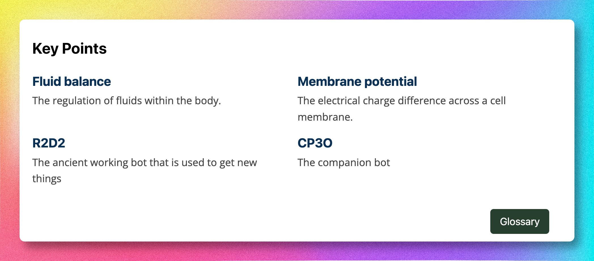
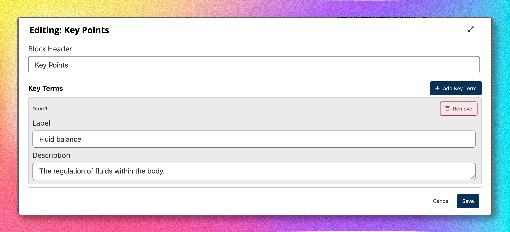

# Keypoint XBlock

A sleek glossary-style XBlock that displays a list of key terms (label + description pairs) in a
responsive two-column grid. Includes an optional header and a configurable call-to-action button.

Both a **student view** and a **studio editor** are fully implemented using React and
[Paragon](https://paragon-openedx.netlify.app/).

## What It Looks Like

### Student View

A two-column grid of key terms with an optional action button:



### Studio Editor

A form to add/remove key terms and configure the header and action button:



## How to Use

### 1. Install the exemplar-blocks package

Add the package to your Open edX installation. For example, in a
[Tutor](https://docs.tutor.edly.io/) setup, add to `config.yml`:

```yaml
OPENEDX_EXTRA_PIP_REQUIREMENTS:
  - git+https://gitlab.com/opencraft/dev/exemplar-blocks.git@main
```

Then rebuild and restart:

```bash
tutor images build openedx      # or openedx-dev for development
tutor dev stop && tutor dev start
```

### 2. Enable in your course

1. Open your course in **Studio**.
2. Go to **Settings → Advanced Settings**.
3. In the **Advanced Module List**, add `"keypoints"`.
4. Save.

### 3. Add to a unit

1. Open any unit in Studio.
2. Click **Advanced → Key Points** to insert the block.
3. Click **Edit** on the block to open the studio editor.
4. Configure:
   - **Block Header** — the title displayed above the key terms (e.g. "Key Concepts to Explore").
   - **Key Terms** — click "Add Key Term" to add label + description pairs. Each term can be
     individually removed.
   - **Action Button** — optional button text and URL shown at the bottom right of the student
     view (e.g. a link to a glossary page).
5. Click **Save**.

## XBlock Fields

| Field          | Type     | Scope     | Description                                          |
|----------------|----------|-----------|------------------------------------------------------|
| `display_name` | `String` | settings  | Component name shown in Studio                       |
| `header`       | `String` | content   | Main header displayed above the key terms            |
| `keypoints`    | `List`   | content   | List of `{"keypoint": "...", "description": "..."}` dicts |
| `button_text`  | `String` | content   | Label for the optional action button                 |
| `button_link`  | `String` | content   | URL the action button links to                       |

## Architecture

### Backend (`keypoint_block.py`)

The `KeypointXBlock` class:

- Defines the XBlock fields listed above.
- Provides `student_view` and `studio_view` methods that return HTML fragments with thin
  JavaScript loaders.
- Exposes a `studio_save` JSON handler that persists editor changes.
- Includes two workbench scenarios for local development.

### Frontend (`frontend/src/keypoint-block/`)

The React UI is built with Vite and compiled into the `public/` directory. See the
[frontend README](../../../frontend/src/keypoint-block/README.md) for detailed component
documentation.

### How the pieces connect

```
student_view / studio_view
  └─ returns Fragment with:
       ├─ static/html/keypoint.html        (mount-point div)
       ├─ static/js/student.js or studio.js (thin JS loader)
       ├─ public/frontend.css               (compiled styles)
       └─ passes data + URL to public/keypointBlock*.js (compiled React bundle)

studio_save handler
  └─ receives JSON from the React editor's $.post call
  └─ updates XBlock fields
```

## File Structure

```
keypoint_block/
├── __init__.py                          # Exports KeypointXBlock
├── keypoint_block.py                    # XBlock class (fields, views, handlers)
├── types.py                             # Python type aliases
├── static/
│   ├── html/
│   │   ├── keypoint.html                # Student view mount point
│   │   └── keypoint_edit.html           # Studio view mount point
│   └── js/
│       ├── student.js                   # Thin loader — imports React student bundle
│       └── studio.js                    # Thin loader — imports React studio bundle
└── public/                              # ⚠️ Built artifacts (generated by Vite)
    ├── frontend.css                     # Compiled CSS
    ├── keypointBlockStudent.js          # Compiled React student UI
    ├── keypointBlockStudio.js           # Compiled React studio UI
    └── jsx-runtime-*.js                 # React JSX runtime chunk
```

## Development

### Prerequisites

Follow the [main project README](../../../README.md) to set up the development environment
(`mise`, `uv`, xblock-sdk, etc.).

### Rebuilding the frontend

From the repository root:

```bash
cd frontend
pnpm install                              # first time only
XBLOCK=keypoint_block pnpm run build      # compile React → public/
```

Or to watch for changes during development:

```bash
XBLOCK=keypoint_block pnpm run build:watch
```

### Running in the workbench

```bash
mise run init_sdk    # first time only
mise run dev         # starts the xblock-sdk dev server
```

Then open [http://localhost:8000/scenario/keypointblock-with-example-data/](http://localhost:8000/scenario/keypointblock-with-example-data/)
to see the block with sample data.

### Running tests

```bash
# Python
mise run test-python

# Frontend (from the frontend/ directory)
pnpm run test
```
